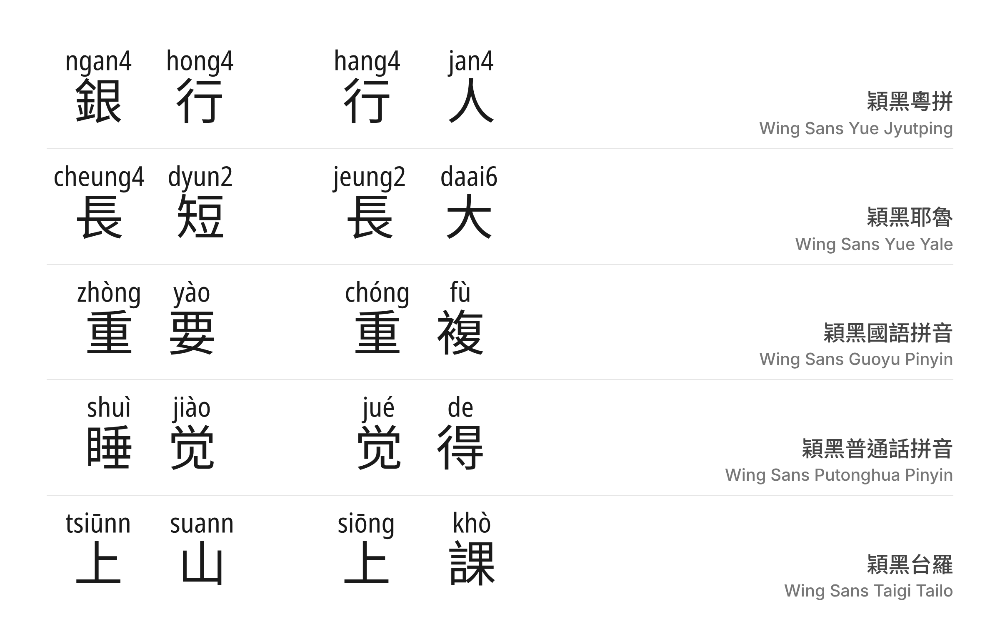

# 穎黑 / Wing Sans
Open-source Chinese fonts that show each character's reading — Jyutping, Yale, Hanyu Pinyin (Guoyu or Putonghua) or Tâi-lô — right above it.

在每個漢字上方直接標示讀音（粵拼、耶魯、漢語拼音、台羅）的開源中文字型。



## 簡介

不少學生和自學者會寫中文，卻不敢開口讀，因為不知道字怎樣唸。Wing Sans 把讀音直接做進字型：裝好字型、換上字體，文字上方就自動出現拼音，不需要另外排版或標注工具。標音是字形的一部分，能在不同軟件中（如 Word，Affinity，Canva，Chrome，Safari，Firefox）使用。

多音字會按前後文自動選擇讀音（例如粵語「銀**行**」hong4、「**行**人」hang4）；選錯了，也可以在字後面打數字或自訂讀音手動更正。

本字型以 [Wing Font Generator](https://github.com/chunlaw/wing-font-generator) 產生，漢字取自 Noto Sans HK／TC／SC，拼音取自 Noto Sans，均為 SIL OFL 開源字型。

| 字型 | 中文名 | 讀音 | 漢字字型 |
| --- | --- | --- | --- |
| Wing Sans Yue Jyutping | 穎黑粵拼 | 粵語・粵拼 | Noto Sans HK |
| Wing Sans Yue Yale | 穎黑耶魯 | 粵語・耶魯拼音 | Noto Sans HK |
| Wing Sans Guoyu Pinyin | 穎黑國語拼音 | 國語・漢語拼音 | Noto Sans TC |
| Wing Sans Putonghua Pinyin | 穎黑普通話拼音 | 普通话・汉语拼音 | Noto Sans SC |
| Wing Sans Taigi Tailo | 穎黑台羅 | 台語・台羅 | Noto Sans TC |

## 最新版本與下載方式

請到本頁右側「[Releases](https://github.com/Wing-Font/wing-sans-chinese/releases)」下載最新版本的 .ttf 字型檔，安裝即可使用。

本字型正準備提交至 Google Fonts。

想用其他字型、其他拼音方案或語言，可到 [wing-font.chunlaw.io](https://wing-font.chunlaw.io) 在瀏覽器內自行產生。

## 使用方式

* **自動選音**：直接輸入文字即可。詞語內的多音字會按詞選音，單字則用最常見讀音。
* **選擇其他讀音**：在字後面打半形數字，`行1`、`行2`⋯⋯ 選第幾個讀音，`行0` 清除讀音。
* **自訂讀音（DIY）**：在字後面打全形 `０`，再打全形拼音，例如 `行０ｈａｎｇ４`，該字就會標上 hang4。字典沒有收錄或標錯的讀音都可以這樣更正。漢語拼音和台羅以數字標調輸入，會自動顯示調號（`行０ｘｉｎｇ２` → xíng、`行０ｋｉａｎｎ５` → kiânn）。粵拼、兩款漢語拼音和台羅支援此功能，耶魯拼音暫不支援。

## 備註

1. 讀音資料來自字典和開源詞庫（見下文），準確度有賴社群持續改進。如發現讀錯，請在 [issues](https://github.com/Wing-Font/wing-sans-chinese/issues) 回報。
2. DIY 自訂讀音的位置以瀏覽器及 Google 文件為準置中；在 Microsoft Word 中會略為偏左（約 0.125 字寬）。
3. 為容納拼音，字型的行高和字寬比一般中文字型大。
4. 字型檔約 20 多 MB，網頁使用時建議經 Google Fonts 等服務按需載入。

## 開源授權規定

* 本字型以 [SIL Open Font License 1.1](https://openfontlicense.org) 發佈，改造自 [Noto Sans HK](https://fonts.google.com/noto/specimen/Noto+Sans+HK)、[Noto Sans TC](https://fonts.google.com/noto/specimen/Noto+Sans+TC)、[Noto Sans SC](https://fonts.google.com/noto/specimen/Noto+Sans+SC)（Adobe，Reserved Font Name "Source"）及 [Noto Sans](https://fonts.google.com/noto/specimen/Noto+Sans)（The Noto Project Authors）。
* Noto 是 Google LLC 的商標；Source 是 Adobe 的商標。
* 任何人都可以免費使用本字型，包括商業用途，無須通知作者。
* 可自由傳送、分享，或與其他軟體綑綁發行、銷售，但必須同時附上授權檔（OFL.txt）。
* 可自由改造、衍生並公開，修改後的字型必須同樣以 SIL OFL 發佈。
* 依照 SIL OFL 規定，**禁止單獨出售字型檔（ttf/otf）**。

## 讀音資料來源與署名

### 粵語（粵拼、耶魯拼音）

粵拼讀音改編自 [TypeDuck](https://github.com/TypeDuck-HK/schema)（TypeDuck 團隊），以 [CC BY 4.0](https://creativecommons.org/licenses/by/4.0/) 授權。

修改內容：Wing Font 重新計算了讀音權重、與其他來源合併，並轉換為 OpenType 選音規則。耶魯拼音版使用相同的字詞及權重，以耶魯拼音書寫。詳見 [wing-font-generator](https://github.com/chunlaw/wing-font-generator/tree/main/python/mappings/cantonese)。

### 國語（Wing Sans Guoyu Pinyin）

中華民國教育部（Ministry of Education, R.O.C.）。《重編國語辭典修訂本》（版本編號：2015_20260625，經 [g0v/moedict-data](https://github.com/g0v/moedict-data) 取得）網址：https://dict.revised.moe.edu.tw/

中華民國教育部（Ministry of Education, R.O.C.）。《國語辭典簡編本》（2014 版，2026-09-29 下載）網址：https://dict.concised.moe.edu.tw/

兩者均以 [創用 CC 姓名標示－禁止改作 3.0 台灣](https://creativecommons.org/licenses/by-nd/3.0/tw/) 授權。讀音照錄原典（「一」「不」變調取自簡編本），唯「一」在量詞前的變調按規則產生（如「一個」yí ge）；Wing Font 將讀音轉換為 OpenType 選音規則。使用說明：[《重編國語辭典修訂本》使用說明](https://language.moe.gov.tw/001/Upload/Files/site_content/M0001/respub/reviseddict_10312.pdf)。

### 普通話（Wing Sans Putonghua Pinyin）

單字讀音取自 [mozillazg/pinyin-data](https://github.com/mozillazg/pinyin-data)，詞語讀音取自 [mozillazg/phrase-pinyin-data](https://github.com/mozillazg/phrase-pinyin-data)，均以 MIT 授權（著作權聲明見各專案 LICENSE）；單字讀音源自 [Unicode Unihan](https://www.unicode.org/charts/unihan.html) 資料庫（Unicode License）。Wing Font 將讀音轉換為 OpenType 選音規則，只保留基本區（U+4E00–9FFF）漢字。

### 台語（台羅）

中華民國教育部（Ministry of Education, R.O.C.）。《臺灣台語常用詞辭典》（[ChhoeTaigiDatabase](https://github.com/ChhoeTaigi/ChhoeTaigiDatabase) 2021-08-08 版，commit 858b8b4）網址：https://sutian.moe.edu.tw/

以 [創用 CC 姓名標示－禁止改作 3.0 台灣](https://creativecommons.org/licenses/by-nd/3.0/tw/) 授權。台羅讀音照錄 ChhoeTaigi 轉錄的原典；Wing Font 將讀音轉換為 OpenType 選音規則。

## Wing Font 家族

- [wing-font-generator](https://github.com/chunlaw/wing-font-generator)：產生標音字型的工具，亦可 `pip install wing-font` 使用。
- [Wing Font 網站](https://wing-font.chunlaw.io)：在瀏覽器內產生、預覽、下載各種標音字型。
- [Wing Font PowerPoint 增益集](https://wing-font-ppt.chunlaw.io/)：在 PowerPoint 內更正多音字讀音。

## 建置

```sh
pip install -r requirements.txt   # 固定版本的 wing-font
python3 build.py                  # 產生所有字型至 fonts/ttf/；或 python3 build.py jyutping 只產生一款
```

所有輸入檔（`srcfonts/` 的漢字字型、`mappings/` 的讀音資料）均以網址及 sha256 鎖定於 `upstream_sources.json`。字型清單及產生參數見 `tools/families.py`。`ofl/` 內各字型的 `METADATA.pb`、`OFL.txt` 和 `article/` 與 google/fonts 的 `ofl/` 結構相同，提交 Google Fonts 時可直接使用。字型版本號設定於 `tools/families.py` 的 `VERSION`（例如 `1.000`）；發佈時推送相同的 tag（例如 `v1.000`），GitHub Actions 會檢查兩者一致，再自動建置並發佈至 Releases。

## 介紹影片

Wing Font 的英文介紹影片：示範輸入時自動標音、按詞語轉讀音（「行」hang4／「銀行」hong4）、在 Word 中自訂讀音，以及其他語言和拼音方案。影片介紹的是整個 Wing Font 工具，部分功能不在 Wing Sans 之內。

[](https://www.youtube.com/watch?v=Ky5q5ym68NA)
